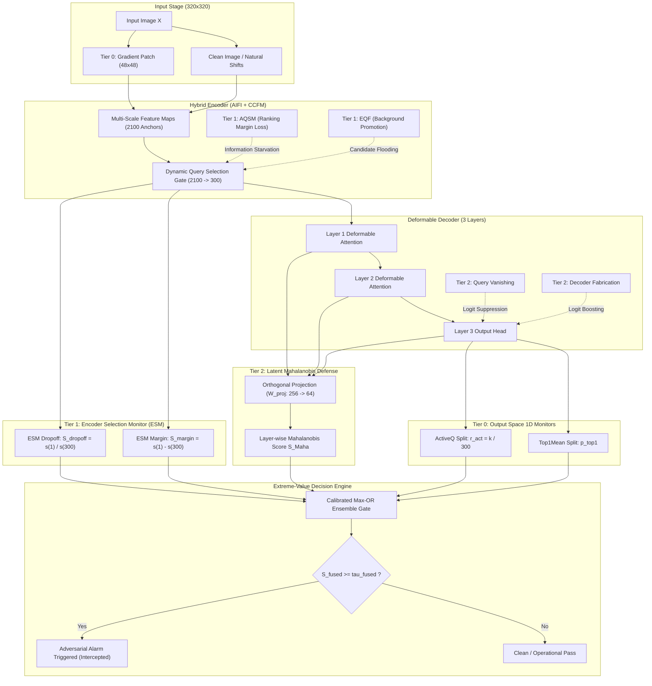
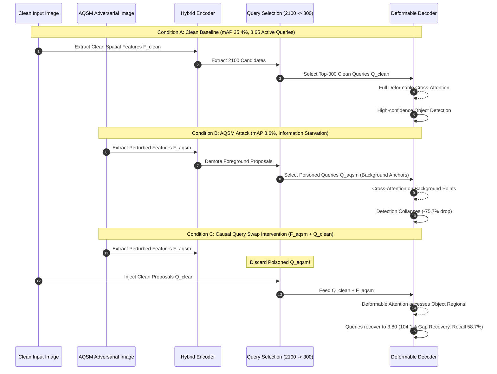

# ĐẶC TẢ NGHIỆP VỤ KHOA HỌC & KIẾN TRÚC HỆ THỐNG PHÒNG THỦ BIÊN CHO REAL-TIME DETECTION TRANSFORMERS (`edge_sec_pro`)

**Phòng Thí Nghiệm**: Intelligent Computing for Sustainable Development Laboratory (IC4SD), Học viện Công nghệ Bưu chính Viễn thông (PTIT), Hà Nội, Việt Nam.  
**Dự Án Nghiên Cứu**: *Towards Trustworthy Real-Time Detection Transformers: An Empirical Investigation of Architectural Vulnerabilities and Lightweight Guardrail Boundaries* (Elsevier EAAI).  
**Mục Tiêu Kỹ Thuật**: Cung cấp bộ giải pháp phần mềm hoàn chỉnh, chuẩn production, tự chứa (self-contained) bao gồm: phân loại kịch bản đe dọa, mô hình toán học các đòn tấn công xuyên tầng, khung phòng thủ giám sát suy luận thụ động nhẹ (overhead 2.12%), và giao thức thực nghiệm can thiệp nhân quả trên RT-DETR.

---

## 1. Bối Cảnh Công Nghệ & Điểm Yếu Kiến Trúc Cốt Lõi

### 1.1. Sự Dịch Chuyển Từ CNN Sang Transformer Tại Biên (Edge AI)
- Trong hơn một thập kỷ, các mô hình tích chập (YOLOv4/v7, SSD) chiếm ưu thế tại biên nhờ độ trễ thấp. Tuy nhiên, CNN phụ thuộc cốt tử vào thuật toán hậu xử lý **Non-Maximum Suppression (NMS)** với độ phức tạp $\mathcal{O}(N^2)$ theo số lượng bounding box dự đoán. Điểm yếu này tạo ra bề mặt tấn công cho các đòn *Computational Sponge Attacks* (ví dụ Overload, Phantom Sponges), làm trễ tính toán bùng nổ và tê liệt hệ thống thời gian thực.
- **Real-Time Detection Transformer (RT-DETR)** loại bỏ hoàn toàn NMS bằng cách tiếp cận bài toán phát hiện vật thể dưới dạng dự đoán tập hợp trực tiếp (Direct Set Prediction) thông qua Attention biến dạng đa quy mô (Multi-Scale Deformable Attention) và gán nhãn Bipartite Hungarian Matching. Do luôn xử lý một quần thể cố định $N_q = 300$ queries, RT-DETR triệt tiêu hoàn toàn sponge attack nhắm vào NMS.

### 1.2. Lỗ Hổng Cơ Chế Chọn Lọc Query Động (Dynamic Query Selection Single Point of Failure)
- Khác với DETR nguyên bản sử dụng query tĩnh (static learnable embeddings), RT-DETR sử dụng cơ chế **Dynamic Query Selection**:
  1. Hybrid Encoder xử lý các bản đồ đặc trưng đa quy mô ($S_3, S_4, S_5$) tại độ phân giải $320 \times 320$, tạo ra tổng cộng $N_{\mathrm{cand}} = 40 \times 40 + 20 \times 20 + 10 \times 10 = 2100$ candidate anchors.
  2. Đầu phân loại của Encoder tính toán vector logit $\hat{L}_i^{\mathrm{enc}} \in \mathbb{R}^C$ ($C=80$).
  3. Lấy ra $N_q = 300$ candidates có điểm tự tin $s_i^{\mathrm{enc}} = \max_c \sigma(\hat{L}_{i, c}^{\mathrm{enc}})$ cao nhất làm điểm tham chiếu (reference points) và content queries sơ khởi truyền vào Deformable Decoder 3 tầng.
- **Lỗ hổng cốt tử**: Kẻ tấn công không cần phải phá vỡ toàn bộ 3 tầng Deformable Cross-Attention của Decoder; thay vào đó, chỉ cần can thiệp vào hàm phân hạng tại cổng Encoder để tráo đổi các đề xuất foreground thực sự xuống dưới background anchors.
- **Hiện tượng Bỏ Đói Thông Tin (Information Starvation)**: Vì Deformable Attention chỉ lấy mẫu đặc trưng cục bộ xung quanh điểm tham chiếu ($K=4$ điểm lấy mẫu cho mỗi scale), khi các điểm tham chiếu bị đẩy vào vùng background, Decoder hoàn toàn không thể tiếp cận thông tin vật thể foreground, dẫn đến sự sụp đổ nghiêm trọng về độ chính xác phát hiện (mAP@50 giảm từ **35.4%** xuống **8.6%**, mức sụt giảm tương đối **-75.7%**).

---

## 2. Phân Loại Không Gian Đe Dọa Toàn Diện (Threat Model Taxonomy: 4 Tiers)

Mô hình đe dọa giả định kẻ tấn công có quyền truy cập hộp trắng (White-box access) vào trọng số và đồ thị tính toán của mô hình RT-DETR-\texttt{r18vd}, với ngân sách nhiễu chuẩn $\ell_\infty \le \epsilon = 16/255 \approx 0.0627$, tối ưu hóa bằng Projected Gradient Descent (PGD) qua $T = 15$ bước, bước nhảy $\alpha = 2.0/255$.

### 2.1. Tier 0: Tấn Công Bề Mặt Đầu Vào Cục Bộ (Localized Input Surface Attack)
- **Gradient Patch ($48 \times 48$, 2.25% diện tích)**: Kẻ tấn công tạo một mảng nhiễu kích thước $48 \times 48$ đặt tại tọa độ ngẫu nhiên trên ảnh:
  $$\delta_{\mathrm{patch}} = \arg\max_{\delta \in [0, 1]^{3 \times 48 \times 48}} \mathcal{L}_{\mathrm{task}}(X \odot (1 - M) + \delta \odot M),$$
  trong đó $M$ là binary mask vị trí patch. Patch tối ưu hóa gradient qua 100 bước với learning rate $\eta=0.1$.
- **Đặc trưng**: Đạt Attack Success Rate (ASR) **89.0% [81.2%, 94.4%]**, gây nhiễu loạn mục tiêu tại vị trí dán patch mà không làm biến dạng toàn cảnh (mAP@50 giảm nhẹ -4.5%, từ 35.4% về 33.8%).

### 2.2. Tier 1: Tấn Công Cơ Chế Chọn Lọc Động Tại Encoder (Encoder Stage Attacks)
- **Adversarial Query Selection Manipulation (AQSM)**:
  Kẻ tấn công xác định tập chỉ số đề xuất foreground $\mathcal{C}_{\mathrm{fg}} \subset \{1, \dots, N_{\mathrm{cand}}\}$ ($|\mathcal{C}_{\mathrm{fg}}| = 10$) có độ tự tin cao nhất trên ảnh sạch và tập background $\mathcal{C}_{\mathrm{bg}}$ gồm các candidate đứng ngay sát ngưỡng cắt top-$N_q$ ($k \in [N_q - 5, N_q + 25]$).
  Hàm mất mát phân hạng bù trừ:
  $$\mathcal{L}_{\mathrm{aqsm}}(X + \delta) = \max\left(0, \frac{1}{|\mathcal{C}_{\mathrm{fg}}|} \sum_{i \in \mathcal{C}_{\mathrm{fg}}} s_i^{\mathrm{enc}}(X + \delta) - \frac{1}{|\mathcal{C}_{\mathrm{bg}}|} \sum_{j \in \mathcal{C}_{\mathrm{bg}}} s_j^{\mathrm{enc}}(X + \delta) + \gamma\right) + \lambda_{\mathrm{rank}} \sum_{i \in \mathcal{C}_{\mathrm{fg}}} \left(s_i^{\mathrm{enc}}(X + \delta)\right)^2,$$
  với lề phân hạng $\gamma = 0.20$ và trọng số suy giảm $\lambda_{\mathrm{rank}} = 1.0$.
  - **Hệ quả**: Triệt tiêu proposal của các vật thể thực, đẩy background vào Deformable Decoder, làm sụp đổ mAP@50 xuống **8.6%** (-75.7% drop, ASR 70.0%).
- **Encoder Query Fabrication (EQF)**:
  Tấn công thúc đẩy background trực tiếp tại đầu phân loại của Encoder nhằm kích hoạt class mục tiêu $c_{\mathrm{target}}$:
  $$\mathcal{L}_{\mathrm{eqf}}(X + \delta) = - \frac{1}{|\mathcal{C}_{\mathrm{bg}}|} \sum_{j \in \mathcal{C}_{\mathrm{bg}}} \hat{L}_{j, c_{\mathrm{target}}}^{\mathrm{enc}}(X + \delta).$$
  - **Hệ quả**: Bơm 300 queries giả ngay từ nguồn xuất phát, đạt **100.0% ASR**, làm mAP sụp đổ xuống **8.2%**.

### 2.3. Tier 2: Tấn Công Không Gian Đầu Ra Deformable Decoder
- **PGD Query Vanishing (Object Suppression)**:
  Triệt tiêu độ tự tin của $K=10$ queries có confidence cao nhất trên ảnh sạch:
  $$\mathcal{L}_{\mathrm{vanish}}(X + \delta) = \frac{1}{|\mathcal{I}_{\mathrm{clean}}|} \sum_{i \in \mathcal{I}_{\mathrm{clean}}} \left( \sigma\left( \max_{c} \hat{L}_{i, c}^{(L)}(X + \delta) \right) \right)^2.$$
  - **Hệ quả**: Xóa sổ vật thể khỏi tầm nhìn của xe tự hành / robot (ASR 51.7%, mAP@50 giảm về **6.3%** [-82.2% drop]).
- **PGD Decoder Query Fabrication (DQF, False Positive Injection)**:
  Lấy $K=5$ queries background (clean confidence $< 0.10$) và tối đa hóa logit mục tiêu:
  $$\mathcal{L}_{\mathrm{fab}}(X + \delta) = - \frac{1}{|\mathcal{I}_{\mathrm{bg}}|} \sum_{i \in \mathcal{I}_{\mathrm{bg}}} \hat{L}_{i, c_{\mathrm{target}}}^{(L)}(X + \delta).$$
  - **Hệ quả**: Kích hoạt phanh khẩn cấp giả mạo (Phantom Braking), đạt **100.0% ASR**, mAP@50 giảm về **8.9%**.

### 2.4. Tier 3: Tấn Công Thích Nghi Né Tránh Phòng Thủ (Defense-Aware Adaptive Evasion)
Kẻ tấn công xây dựng hàm mục tiêu kết hợp (Joint Objective):
$$\mathcal{L}_{\mathrm{adaptive}}(X + \delta) = \mathcal{L}_{\mathrm{task}}(X + \delta) + \lambda \mathcal{L}_{\mathrm{monitor}}(X + \delta),$$
với hàm phạt né tránh bản lề mịn (Smooth Hinge Penalty):
$$\mathcal{L}_{\mathrm{monitor}} = \left( \frac{\mathrm{ReLU}(\tau_{\mathrm{act}}^{\min} - \tilde{r}_{\mathrm{act}}) + \mathrm{ReLU}(\tilde{r}_{\mathrm{act}} - \tau_{\mathrm{act}}^{\max})}{\sigma_{\mathrm{act}}} \right)^2 + \left( \frac{\mathrm{ReLU}(\tau_{\mathrm{top}}^{\min} - \bar{p}_{\mathrm{top1}}) + \mathrm{ReLU}(\bar{p}_{\mathrm{top1}} - \tau_{\mathrm{top}}^{\max})}{\sigma_{\mathrm{top1}}} \right)^2.$$
Để truyền đạo hàm qua phép đếm rời rạc, kẻ tấn công dùng hàm xấp xỉ khả vi Sigmoid nhiệt độ cao:
$$\tilde{r}_{\mathrm{act}} = \frac{1}{N_q} \sum_{i=1}^{N_q} \mathrm{Sigmoid}\left( 25 \cdot \left( \max_c \sigma(\hat{L}_{i, c}^{(L)}) - 0.35 \right) \right).$$
Khi tấn công đa tầng kết hợp Mahalanobis (**Joint Adaptive Evasion**), kẻ tấn công thêm vào hàm phạt: $\lambda_{\mathrm{maha}} \cdot \mathrm{ReLU}(S_{\mathrm{Maha}} - \tau_{\mathrm{maha}})^2$.

---

## 3. Khung Phòng Thủ Đa Tầng Nhẹ & Hiệu Chuẩn Phân Vị (Reliability-Aware Defense)

Khung phòng thủ khai thác đặc trưng thuần túy từ luồng forward-pass (không can thiệp retraining, không ảnh hưởng clean mAP).

### 3.1. Giao Thức Hiệu Chuẩn Phân Vị Hai Phía Không Dùng Oracle (Split-Percentile Quantile Mapping)
- **Vấn đề Tail Trap trong Kiểm định Đối xứng**: Với các chỉ số lệch phải mạnh như tỷ lệ query tích cực $r_{\mathrm{act}}$, kiểm định chuẩn hóa $|z| = |x - \mu|/\sigma$ đẩy ngưỡng dưới $\mu - 2\sigma < 0$. Dưới đòn Vanishing, $r_{\mathrm{act}} = 0$ không bao giờ nhỏ hơn số âm, dẫn tới **TPR = 0.0%** dù AUROC đạt 0.909.
- **Giải pháp Split-Percentile**: Phân bổ ngân sách sai số $\alpha = 0.05$ đều cho hai đuôi phân phối thực nghiệm trên tập Calibration sạch ($N_{\mathrm{cal}} = 1000$):
  $$\tau_{\mathrm{lower}} = \mathrm{Quantile}\left(\mathcal{D}_{\mathrm{cal}}, \frac{\alpha}{2}\right), \quad \tau_{\mathrm{upper}} = \mathrm{Quantile}\left(\mathcal{D}_{\mathrm{cal}}, 1 - \frac{\alpha}{2}\right).$$
- Ánh xạ điểm dị thường liên tục:
  $$S_{\mathrm{split}}(x) = 2 \cdot \left| \hat{F}_{\mathrm{clean}}(x) - 0.5 \right| \in [0, 1].$$

### 3.2. Cấu Trúc Các Tuyến Giám Sát Chi Tiết

| Kênh Giám Sát | Tầng Kiến Trúc | Đại Lượng Đo Lường | Bản Chất Tín Hiệu & Độ Nhạy |
|---|---|---|---|
| **$\mathcal{M}_1$: ActiveQ Split** | Tier 0 (Output 1D) | $r_{\mathrm{act}} = \frac{1}{N_q} \sum \mathbb{I}(\max \sigma > 0.35)$ | Đo đếm số vật thể kích hoạt. Bắt Vanishing **100.0% TPR**, DQF 38.3%. |
| **$\mathcal{M}_2$: Top1Mean Split** | Tier 0 (Output 1D) | $\bar{p}_{\mathrm{top1}} = \frac{1}{K} \sum \max \sigma(\hat{L}_i)$ | Đo độ tự tin trung bình. Bắt AQSM **55.0% TPR**, EQF 56.7%. |
| **$\mathcal{M}_3$: ESM Dropoff** | Tier 1 (Encoder Gate) | $S_{\mathrm{dropoff}} = \frac{s_{(1)}^{\mathrm{enc}} + \epsilon}{s_{(300)}^{\mathrm{enc}} + \epsilon}$ | Đo độ dốc năng lượng proposal. Bắt AQSM **68.3% TPR** (AUROC 0.882). |
| **$\mathcal{M}_{3b}$: ESM Margin** | Tier 1 (Encoder Gate) | $S_{\mathrm{margin}} = s_{(1)}^{\mathrm{enc}} - s_{(300)}^{\mathrm{enc}}$ | Chuyên biệt phát hiện candidate flooding. Bắt EQF **83.3% TPR** (AUROC 0.979). |
| **$\mathcal{M}_4$: Layer Mahalanobis** | Tier 2 (Deep Latent) | $S_{\mathrm{Maha}} = \max_l (v^{(l)} - \mu_l)^\top (\Sigma_l + \beta I)^{-1} (v^{(l)} - \mu_l)$ | Chiếu trực giao $d_{\mathrm{proj}}=64$ trên 3 tầng decoder. Bắt Joint Adaptive **36.7% TPR** (AUROC 0.875). |

### 3.3. Cổng Dung Hợp Cực Trị Calibrated Max-OR (Extreme-Value Fusion Gate)
Để hợp nhất $M=4$ kênh mà không làm bùng nổ tỷ lệ báo động sai, điểm dị thường tổng hợp được tính theo phân vị cực trị:
$$S_{\mathrm{fused}}(x) = \max_{k=1}^M q_k(x), \quad q_k(x) = \hat{F}_k(S_k(x)).$$
Ngưỡng gộp $\tau_{\mathrm{fused}}$ được xác định thực nghiệm trên tập $\mathcal{D}_{\mathrm{cal}}$ sao cho:
$$\frac{1}{N_{\mathrm{cal}}} \sum_{i=1}^{N_{\mathrm{cal}}} \mathbb{I}\left( S_{\mathrm{fused}}(X_i^{\mathrm{cal}}) \ge \tau_{\mathrm{fused}} \right) = \alpha = 0.05.$$
Trên tập kiểm thử sạch độc lập ($N_{\mathrm{test}} = 500$, zero leakage), Calibrated Max-OR duy trì FPR thực tế ở **4.2% [2.6%, 6.3%]**, và từ **0.0% đến 3.0%** dưới các biến dạng tự nhiên (nhiễu hạt, mờ chuyển động, ánh sáng yếu).

### 3.4. Giải Mã Toán Học Nghịch Lý Max-OR 26.7% vs ActiveQ 100.0% (Finite Tail Truncation Effect)
Tại sao khi ActiveQ đơn lẻ bắt Vanishing tới **100.0%**, cổng Max-OR gộp chỉ đạt **26.7%**?
1. **Biên Dưới Rời Rạc (Discrete Lower Bound)**: Biến đếm $r_{\mathrm{act}} = k/300 \ge 0$. Trong 1000 ảnh sạch chuẩn hóa, có 23 ảnh tự nhiên không có vật thể ($r_{\mathrm{act}} = 0$, chiếm 2.3%).
2. Do đó, khi ánh xạ qua phân vị hai phía $S_{\mathrm{split}}$, mẫu có $r_{\mathrm{act}} = 0$ rơi vào phân vị thực nghiệm cao nhất chỉ đạt:
   $$q_1(x) = 1 - 0.023 = 0.977.$$
3. Để kiểm soát sai số toàn cục ở mức 5% trên 4 kênh dưới phép lấy Max, ngưỡng $\tau_{\mathrm{fused}}$ bị đẩy lên mức:
   $$\tau_{\mathrm{fused}} \approx 0.9873.$$
4. Vì **$0.977 < 0.9873$**, một đòn tấn công thuần túy ép $r_{\mathrm{act}} \to 0$ mà không làm biến dạng các kênh khác thì về mặt toán học không bao giờ kích hoạt được kênh ActiveQ trong cổng Max-OR! Con số 26.7% phát hiện được là do sự méo mó phụ (collateral distortion) ở các kênh khác.
- **Khuyến nghị kiến trúc**: Hệ thống phòng thủ công nghiệp phải kết hợp cổng Max-OR đa kênh với chốt chặn trực tiếp ngưỡng biên (boundary tripwires) đối với các biến đếm có giới hạn tự nhiên.

### 3.5. Sự Phân Cực Của Bộ Lọc Total Variation (TV Filter Dichotomy)
- Đối với PGD toàn cục $\epsilon = 16/255$, bộ lọc TV bề mặt bắt **100.0% TPR**.
- Tuy nhiên, độ nhạy sụp đổ khi giảm $\epsilon$: ở $\epsilon = 4/255$, TV TPR giảm xuống **21.7%**; ở $\epsilon = 2/255$, TV TPR chỉ còn **8.3%** (sát mức ngẫu nhiên 5%).
- Trước Gradient Patch cục bộ ($48 \times 48$), TV filter hoàn toàn bất lực: chỉ đạt **14.0% TPR**.
- Khi kẻ tấn công làm mượt đạo hàm (Differentiable Smoothing), TV TPR sụp đổ xuống **3.3%**.
- **Ý nghĩa**: Khẳng định sự cần thiết của chiến lược *Phòng thủ chiều sâu (Defense-in-Depth)*: Bộ lọc đầu vào chặn nhiễu thô, còn guardrail nội tại chặn tấn công tinh vi, cục bộ và thích nghi.

---

## 4. Thực Nghiệm Can Thiệp Nhân Quả (Causal Intervention Protocols)

Để loại trừ giả thuyết cho rằng mAP sụp đổ do đặc trưng không gian của Encoder bị phá hủy, nghiên cứu thiết lập 2 bằng chứng nhân quả:

1. **Độ Phủ Ground-Truth Đề Xuất (GT Proposal Coverage)**:
   - Trên ảnh sạch, **86.4% [81.2%, 90.5%]** bounding boxes ground-truth có ít nhất 1 proposal candidate trong top-300 đạt $\mathrm{IoU} \ge 0.5$.
   - Dưới AQSM, độ phủ tụt xuống **24.1% [18.5%, 30.6%]** (sụt giảm **-72.1%**). Chứng minh 75.9% vật thể đã bị bỏ đói ngay trước khi Decoder hoạt động.
2. **Tráo Đổi Query Phản Thực Nghiệm (Counterfactual Causal Swap)**:
   - Lấy đặc trưng không gian bị tấn công $F_{\mathrm{aqsm}}$ nhưng ghép với tọa độ đề xuất sạch $Q_{\mathrm{clean}}$ đưa vào Decoder.
   - Số lượng active queries phục hồi từ 4.80 về **3.80**, thu hồi **104.1%** khoảng cách sai lệch so với mốc sạch 3.65.
   - Độ nhạy phát hiện (Detection Recall) phục hồi từ **18.2%** (AQSM) lên **58.7%** (tiệm cận mức sạch 68.4%).
   - Thử nghiệm nghịch đảo ($F_{\mathrm{clean}} + Q_{\mathrm{aqsm}}$): Dù feature map sạch hoàn hảo, chỉ cần đưa query đầu độc thì số query lập tức bị dìm xuống 3.22 và Recall sụp đổ còn 21.4%.

---

## 5. Bảng Dữ Liệu Đối Đầu Chuẩn Mực Thực Nghiệm (100% Real Checkpoints)

Tất cả số liệu đo lường trên $N_{\mathrm{cal}}=1000, N_{\mathrm{test}}=500$, khoảng tin cậy 95% Clopper-Pearson:

| Kịch Bản Đánh Giá | N | Task ASR [95% CI] | ActiveQ Split | Top1Mean Split | ESM Dropoff | LayerMaha | **Calibrated Max-OR** | Oracle Best Single |
|---|:---:|:---:|:---:|:---:|:---:|:---:|:---:|:---:|
| **Clean Test Set (Ảnh sạch)** | 500 | 0.0% [0.0, 3.6] | 20.2% | 5.2% | 5.4% | 4.8% | **4.2% [2.6, 6.3]** | -- |
| **Control: Gaussian Noise** | 100 | 0.0% [0.0, 3.6] | 16.0% | 4.0% | 3.0% | 3.0% | **3.0% [0.6, 8.5]** | -- |
| **Control: Random Patch** | 100 | 0.0% [0.0, 3.6] | 16.0% | 5.0% | 4.0% | 4.0% | **2.0% [0.2, 7.0]** | -- |
| **Clean Shift: Gaussian Blur** | 100 | 0.0% [0.0, 3.6] | 25.0% | 0.0% | 3.0% | 3.0% | **0.0% [0.0, 3.6]** | -- |
| **Clean Shift: Brightness** | 100 | 0.0% [0.0, 3.6] | 16.0% | 4.0% | 4.0% | 7.0% | **3.0% [0.6, 8.5]** | -- |
| **Tier 0: Gradient Patch** | 100 | 89.0% [81.2, 94.4] | 6.0% | 6.0% | 3.0% | 1.0% | **4.0% [1.1, 9.9]** | Top1 / Act (6.0%) |
| **Tier 1: AQSM** | 60 | 70.0% [56.8, 81.2] | 21.7% | 55.0% | **68.3%** | 3.3% | **56.7% [43.2, 69.4]** | ESM Dropoff (68.3%) |
| **Tier 1: EQF** | 60 | 100.0% [94.0, 100.0] | 38.3% | 28.3% | 6.7% | 26.7% | **38.3% [26.1, 51.8]** | ActiveQ Split (38.3%) |
| **Tier 2: PGD Vanishing** | 60 | 60.0% [46.5, 72.4] | **100.0%** | 25.0% | 28.3% | 10.0% | **26.7% [16.1, 39.7]** | ActiveQ Split (100.0%) |
| **Tier 2: PGD Fabrication** | 60 | 100.0% [94.0, 100.0] | 38.3% | 28.3% | 6.7% | 26.7% | **38.3% [26.1, 51.8]** | ActiveQ Split (38.3%) |
| **Tier 3: 1D Adaptive ($\lambda=0.5$)** | 60 | 100.0% [94.0, 100.0] | 3.3% | 3.3% | 5.0% | **25.0%** | **11.7% [4.8, 22.6]** | LayerMaha (25.0%) |
| **Tier 3: Joint Latent Adaptive** | 60 | 98.3% [91.1, 100.0] | 1.7% | 0.0% | 6.7% | **36.7%** | **6.7% [1.8, 16.2]** | LayerMaha (36.7%) |

---

## 6. Hồ Sơ Hiệu Năng Thời Gian Thực & Khả Thi Triển Khai Biên

- **Cấu hình đo đạc**: Intel Core i7-1165G7 @ 2.80GHz, PyTorch CPU FP32 runtime, thực hiện đo 50 lần lặp liên tục sau giai đoạn warm-up cache.
- **Thời gian suy luận mô hình gốc**: $272.43 \pm 47.61$ ms.
- **Thời gian thực thi toàn bộ tuyến phòng thủ**: $5.78 \pm 0.58$ ms.
  - Phân rã trích xuất: Trích xuất đặc trưng ($6.42 \pm 0.95$ ms), Đánh giá logic phòng thủ ($0.28 \pm 0.12$ ms).
- **Tỷ lệ chi phí thời gian thực (Runtime Overhead)**: **2.12%** (thỏa mãn chỉ tiêu kỹ thuật $< 4.0\%$).
- **Chi phí bộ nhớ RAM**: Trọng số chiếu trực giao $W_{\mathrm{proj}} \in \mathbb{R}^{64 \times 256}$ và ma trận nghịch đảo hiệp phương sai $\Sigma^{-1} \in \mathbb{R}^{64 \times 64}$ tiêu tốn dưới **200 KB**, hoàn toàn khả thi trên các vi điều khiển hoặc board biên nhúng (Jetson Orin Nano, Raspberry Pi 5).

---

## 7. Năm Mối Đe Dọa Đến Giá Trị (Threats to Validity)

1. **Phạm vi Kiến trúc Đơn lẻ**: Thực nghiệm tập trung vào RT-DETR-\texttt{r18vd}. Các biến thể lớn hơn (RT-DETRv2, D-FINE, RT-DETR-X) có thể có mức độ đa dạng hóa attention khác nhau.
2. **Khung hình Rỗng trong Triển khai Thực tế**: Cảnh đêm hoặc đường vắng không có xe ($r_{\mathrm{act}} = 0$) có thể trùng với mẫu của Query Vanishing. Triển khai thực tế cần tích hợp bộ lọc thời gian (temporal Kalman tracking).
3. **Tích lũy Báo động Oan trong Video 30 FPS**: Mức 4.2% mỗi khung hình sẽ gây ra ~1.2 báo động/giây nếu đánh giá độc lập từng frame. Cần áp dụng bộ lọc cửa sổ trượt (Sliding window: chỉ báo động khi 3/5 khung hình liên tiếp bị cờ).
4. **Giới hạn Mô hình Hộp Trắng Kỹ thuật số**: Tấn công patch vật lý ngoài đời chịu ảnh hưởng của góc quay, độ méo thấu kính và thời tiết.
5. **Kỷ luật Không Rò Rỉ Dữ liệu (Zero Leakage)**: Mọi siêu tham số ($\gamma=0.20, \beta=0.05, d_{\mathrm{proj}}=64$) đều được cố định trước trên tập huấn luyện/hiệu chuẩn, hoàn toàn không được tinh chỉnh trên tập kiểm thử.
