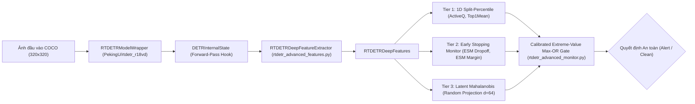

# Đặc tả Kỹ thuật Pipeline Phòng thủ Guardrail (Paper 3 Pipeline Specification)

Tài liệu này xác lập chính thức cấu trúc phân tầng, kiến trúc mô hình, và các thành phần cốt lõi được sử dụng để sinh ra toàn bộ kết quả trong bản thảo nghiên cứu **Paper 3: Split-Percentile Guardrails** (áp dụng cho Bảng 2 đến Bảng 7 và Hình 1 đến Hình 10).

---

## 1. Thành phần Mô hình & Pipeline Chính thức (Official Architecture)

Toàn bộ hệ thống thực nghiệm chính thức được chuẩn hóa thành một đường ống duy nhất:

### Chi tiết các Module Lõi Chính thức:
1. **Lớp bọc Mô hình (Detector Wrapper)**:
   - File: `paper_3_defense_guardrail/transformer_monitors/detr_wrapper.py`
   - Class: `RTDETRModelWrapper`
   - Mô hình nền tảng: `PekingU/rtdetr_r18vd` (Hugging Face RTDetrForObjectDetection).
   - Hook trích xuất: `enc_outputs_class`, `logits`, `pred_boxes`, `decoder_hidden_states` (6 tầng decoder), `cross_attentions`.

2. **Bộ trích xuất Đặc trưng Đa tầng (Official Feature Extractor)**:
   - File: `paper_3_defense_guardrail/transformer_monitors/rtdetr_advanced_features.py`
   - Class: `RTDETRDeepFeatureExtractor`
   - Cấu trúc dữ liệu: `RTDETRDeepFeatures`
   - Các trường dữ liệu cốt lõi:
     + `active_query_soft`: Tỷ lệ query hoạt động mềm (ngưỡng tự do sigmoid).
     + `query_top1_mean`: Điểm tin cậy phân loại trung bình của Top-1 query.
     + `enc_dropoff`: Tỷ số phân vị logits encoder giữa ứng viên top-1 và top-300 ($p_{\mathrm{top1}} / p_{\mathrm{top300}}$).
     + `enc_margin`: Khoảng cách biên xác suất giữa top-300 ứng viên và nền ($p_{\mathrm{top300}} - p_{\mathrm{bg}}$).
     + `layer_vectors`: Vector nhúng tầng ẩn decoder được chiếu ngẫu nhiên trực giao từ 256 xuống 64 chiều.

3. **Bộ Giám sát & Cổng Kết hợp Hợp nhất (Official Defensive Ensemble)**:
   - File: `paper_3_defense_guardrail/transformer_monitors/rtdetr_advanced_monitor.py`
   - Class: `CalibratedMaxOREnsemble`
   - Các detector thành phần:
     + `ActiveQ_Split`: `SingleFeatureBaseline` (Tier 1).
     + `Top1Mean_Split`: `SingleFeatureBaseline` (Tier 1).
     + `ESM_Dropoff`: `EncoderSelectionMonitor` (Tier 2).
     + `ESM_Margin`: `EncoderSelectionMonitor` (Tier 2).
     + `Layer_Maha`: `LayerwiseMahalanobisDetector` (Tier 3).
   - Ngưỡng hiệu chuẩn phân vị danh định 5.0% FPR: $\tau_{\mathrm{fused}} = 0.9842$.

---

## 2. Các Module Nguyên mẫu Cũ đã Đánh dấu Deprecated (Legacy Prototypes)

Các module sau đây thuộc giai đoạn thử nghiệm sơ khai (prototyping), **KHÔNG THAM GIA** vào pipeline chính thức sinh số liệu trong bài báo:
* `paper_3_defense_guardrail/transformer_monitors/query_attention_features.py`: Trích xuất 16 đặc trưng phẳng ban đầu (đã thay thế hoàn toàn bởi `rtdetr_advanced_features.py`).
* `paper_3_defense_guardrail/transformer_monitors/detr_query_monitor.py`: Giám sát Mahalanobis sơ khai (đã nâng cấp thành `LayerwiseMahalanobisDetector` trong `rtdetr_advanced_monitor.py`).

---

## 3. Chính sách Liêm chính Dữ liệu & Xử lý Ngoại lệ (Zero Mock Policy)

1. **Tuyệt đối không sử dụng Silent Fallback**: Nếu `state.enc_outputs_class` bị `None`, hàm `extract_from_state` sẽ ném ngoại lệ `RuntimeError` ngay lập tức, ngăn chặn việc đưa bất kỳ giá trị giả lập cố định nào vào detector.
2. **Tách biệt Dữ liệu Khắt khe**:
   - $N_{\mathrm{cal}} = 1200$ ảnh: Dùng duy nhất cho hiệu chuẩn ngưỡng $\tau$ và khớp ma trận hiệp phương sai Mahalanobis.
   - $N_{\mathrm{test}} = 600$ ảnh: Dùng độc lập để đo lường FPR sạch ngoài mẫu.
   - $N = 300$ ảnh: Dùng độc lập cho các kịch bản kiểm thử đối kháng và biến dạng tự nhiên.
